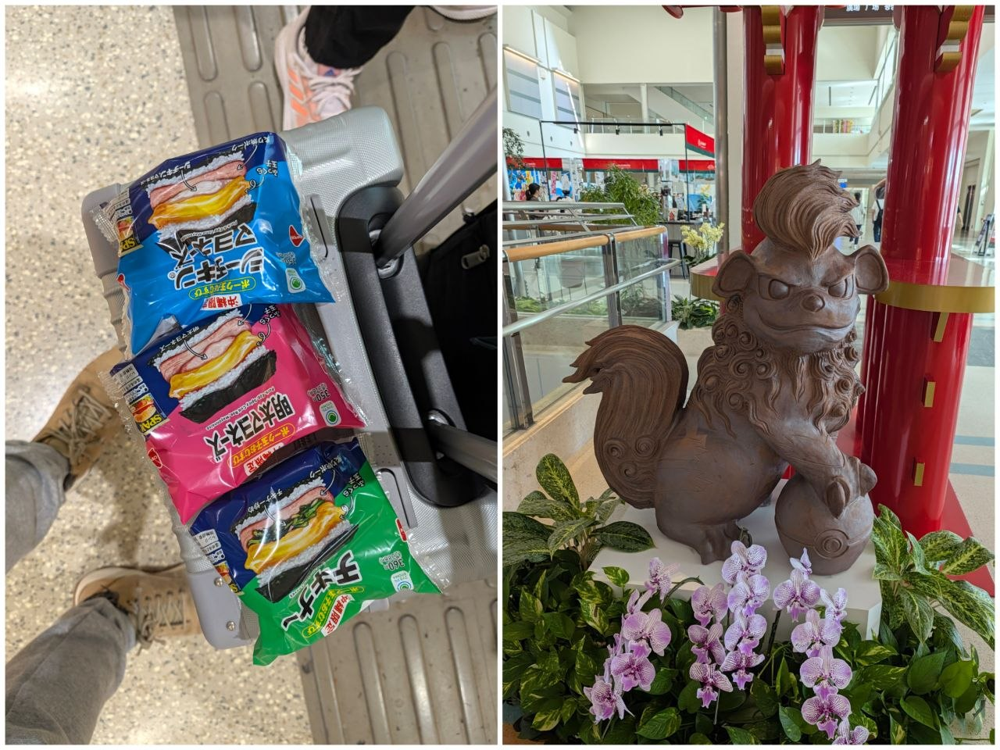
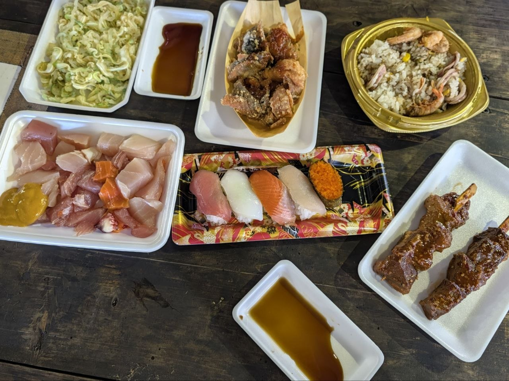
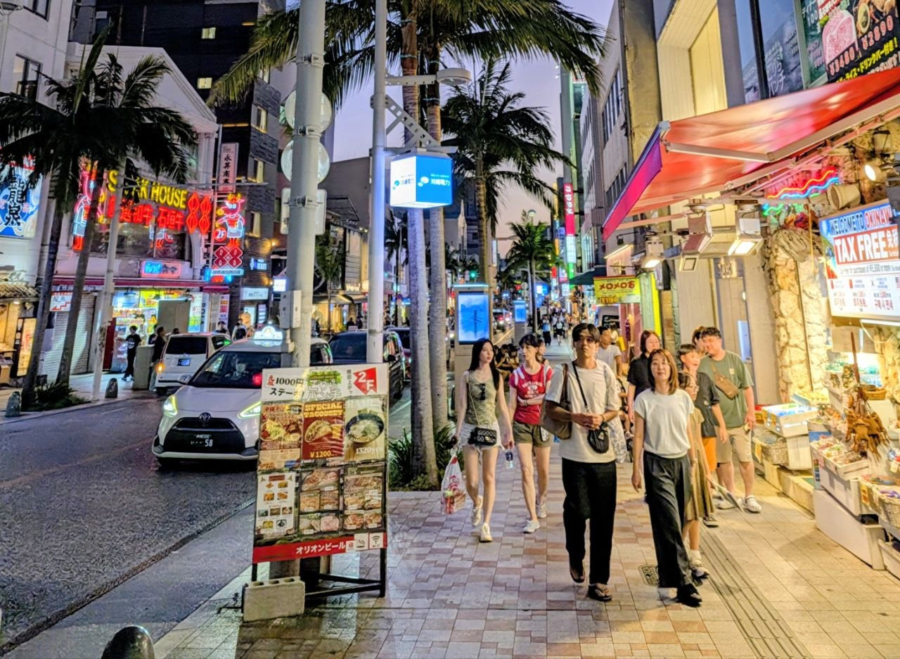
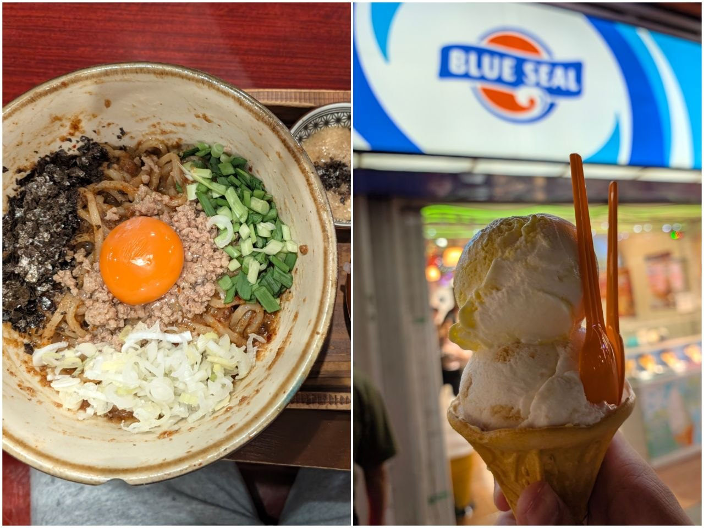

## Trip Details
- **Dates:**  16 September - 23 September
- **Flight Details (To):** Singapore to Naha International Airport, Scoot TR834, 0215 - 0835 (5 h 20 min)
- **Flight Details (Return):** Naha International Airport to Singapore Changi Airport, Scoot TR 835, 0950 - 1355 (5h 5 min)

## Overview and Things to Note
This is a 7D7N trip in Okinawa, taking a red-eye flight from Singapore to Okinawa and returning with a morning flight from Okinawa back to Singapore. Overall, Okinawa is a place with more nature, and has a good mix of city. The cost is relatively low compared to Europe, and the quality and variety of food is really amazing. I highly recommend a road trip as it offers significantly more flexibility and accessibility to several nature spots and to move around the island, given that there are many spots with many attractions throughout the island. The next section describes the driving experience in Naha. 

Naha, or Japan, still relies heavily on cash, this includes parking, paying for toll, many restaurants and stores at sub urban areas. As such, do bring more cash for all expenses.  

## Driving in Okinawa
Driving in Okinawa is really chill, I have not heard a single honk the entire trip while driving. The cars in Okinawa are also very small. My family rented the Suzuki Solio from OTS rent a car, paying a total of 66,220 yen for 7 days. One thing to note is the car rental companies do not provide return services for 24/7, and its kept limited to 10am -5pm, which has to be factored in when planning for the trip.

### Driving on the expressway

On the expressways, there are long stretches of single lane roads where cars will follow the speed limit of 50km/h. So be prepared to tail behind another car for long stretches of the road at 50km/h.

The Electroninc Toll Collection (ETC) system is the toll system in Japan. The payment for the toll is done via cash, or using the ETC card, which can be purchased at the car rental shop. In most cases, it is very possible to avoid tolls in Okinawa. Personally, the only time we were charged for toll was between Kitanakagushuku and Naha, but that was entirely avoidable. As such, I will highly recommend to just pay cash at the toll stations. 

### Parking 
Parking is relatively straightforward in cities, but it can be expensive in the main Naha areas, such as Kosusai Street. The 2 main types of parking are as follows: 

1. Barrier Entry and Exit. when entering the carpark, take the ticket from the machine and the barrier opens. When exiting, return the ticket back to the machine and its associated costs will be displayed. Pay the amount displayed and the barrier will open. 

2. Open Concept Parking. In busy cities, there are carparks with no barriers, but several rows of carpark lots with a small metal hump on the right middle portion of the lot. Drive into the lot normally, and after a short while, the hump will extend upwards, which traps the car. To deactivate the hump when exiting the carpark, go to the machine and indicate the carpark lot number and pay the carpark fee accordingly. THis deactivates the hump and the car can be safely driven out. 

In general, the parking costs can vary from location to location, and night parking has a different fare charging system. As such, it is important to do your due deligence in searching for carparks with lower rates, because it can be literally a 1 min drive and the price will be 100 yen difference per hour. 

### Other generic driving tips
There were several cross junctions at Itoman where there were no traffic lights, so be careful while driving. 

In terms of navigation, one can go to Google Maps to search for the phone number of the destination and indicate it in the car GPS. However, the car GPS can take a huge reroute when there is a more straightforward path, so some self judgement can be exercised to shorten travel times. 

## Day 1

### Morning

The moment we touched down at Naha Airport, we had breakfast at the 7-11 convenience store there. For breakfast, we had several Onigiris, with the seaweed wrapped around various ingredients, ranging from Spam (literally the luncheon meat) to mentaiko. We were taking a walk and found out the mascot Pokemon for Okinawa is Growlithe and Arcanine, representing the Shisa, which are traditional lion-dog guardian statues that are iconic symbols of the region found in front of
many places in Okinawa. 

Afterwhich, we went to collect our car from OTS Rent-a-Car. We had to walk from the international arrivals to the domestic arrivals, and there is a shuttle bus which brought us to the car rental location, which was a 15 minutes drive away. 

The first site that we went to was the Former Japanese Navy Underground Headquaters. The site depicted the lives of the Japanese Imperial Army during the battle of Okinawa. The tunnels served as the command center and air raid shelters for the military, and told the story of how
Rear Admiral Ota fought to the very end and gave his final command to stay put. 

After that, we went to Itoman Fish Market for lunch. There was a wide variety of seafood available for purchase, with many different cooking styles available. The prices were unfortunately pretty steep, and meant to be a tourist site. But food was still good, and Ive never had so much sashimi in my life. Tip is to get the scrap pieces of sashimi, it literally tastes as good as the normal sashimi, but sold for a significantly lower price.

After lunch, we went to the Himeyuri Peace Musuem. I didnt want to take photos because it was a site where man atrocities were commited and I thought it was just basic respect. I remembered the first thing that greeted me was a cave, which I learnt that was an underground hospital where female students were forced to become nurses and tended to wounded soldiers. Many of these students perished because of artillery shells launched into the cave during the Battle of Okinawa. The saddest part of it was that when the US soldiers offered to free them, some of the students rejected it, thinking that they will become prisoner of wars, and they ended up dying during the Battle of Okinawa. 

Overall, my day so far gave me an insight of the lives of the Japanese civillians during the Battle of Okinawa during World War 2, which was something that is often not talked about in the media. Not justifying or defending anyone, but having this insight made me realise the evils of wars and the long standing implications and impacts on countries, and made me treasure this peace a lot more. 

We ended the day exploring Kokusai Street, the main shopping street for Naha. What struck me was how tropical it was, with coconut trees lining the sidewalks of the streets and people dressed in T-shirt and shorts in Singaporean style. 

 We also had some Mazesoba, which was my first time eating dried soba noodles. Flavour was really good and refreshing, with huge amounts of side dishes, such as yam shavings, garlic. We could also order a bowl of rice at the end of the meal to soak up the sauce of the mazesoba, which ended up making the rice really flavourful and umami. We ended the day with some ice cream from Blue Seal, which I found out was created by the American military for the American soldiers when they were in Okinawa. They really had a wide variety of flavours, with unique flavours such as Okinawan Salt Cookies, Beni-Imo (Sweet Potato) and Blue Wave (Tropical and sweet). 

We returned to our hotel, bellies full and happy! Slept early and rested well for the next day! 
